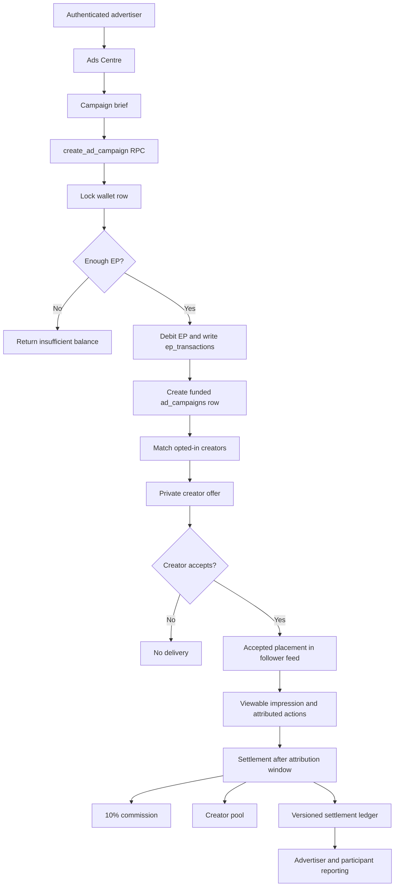

# Xeevia Ads Engine Foundation

## Purpose

The Ads Centre is the product surface for Xeevia's advertising economy. This document records the implemented first release, its safety boundaries, and what remains unproven.

## Trust Equation

`Trust = Identity + Economic Cost + Reputation + Behavioral Consistency + Attributable History`

The equation is a system model, not a marketing slogan:

- **Identity**: a participant has a persistent, verifiable account and relationship context.
- **Economic cost**: actions carry a small EP cost that makes mass automated behavior less attractive while preserving normal use.
- **Reputation**: contribution quality and verified participation accumulate over time.
- **Behavioral consistency**: repeated behavior is evaluated for relevance, authenticity, and manipulation patterns.
- **Attributable history**: campaign evidence and settlement are linked in the campaign ledger; XRC integration remains future work.

No single factor is sufficient. EP cost alone is not proof of trust; identity alone is not proof of contribution.

## Product Principle

Xeevia should feel like everyday social life on the surface and like accountable economic infrastructure underneath.

- Reading and ordinary conversation must remain fast and familiar.
- Campaign participation must be explicit and clearly labeled.
- Users must not be exposed to private-message advertising.
- Profile Boost, verification, reputation, and sponsorship must remain separate concepts.
- The platform must never reward volume alone when quality, relevance, or outcome can be measured.

## Campaign Value Model

A campaign creator pool is allocated with versioned, measurable rules:

```text
70% of creator pool -> proportional to deduplicated viewable impressions
30% of creator pool -> proportional to deduplicated qualified outcomes
```

Current outcomes are campaign clicks, follows after a campaign click, and community joins after a campaign click. Follow and community outcomes require the action within seven days of the click. Impressions are limited to one per campaign, creator, viewer, and UTC day. These signals support proportional allocation but are not proof of attention or fraud-free behavior.

## Implemented Marketplace Foundation

Migration `107_creator_ads_marketplace.sql` and the Ads Centre implement a controlled first release:

- Advertisers upload a video, choose a goal, declared creator topics, a minimum follower count, creator invitation count, HTTPS destination, dates, and EP budget.
- The 10% commission is either included in the stated amount or added to the creator budget. The creator pool is divided 70% by viewable impressions and 30% by attributed outcomes.
- Campaign creation and escrow debit are atomic. Matching is limited to creators who opted in and selected matching topics; invitations do not publish ads.
- Creators can review the creative, terms, and campaign pool, then accept or decline. Only accepted campaigns can appear in the Home feed, and only to followers of participating creators.
- Sponsored feed cards are labeled, have hide/report controls, and are limited to three placements per feed request and one impression per campaign/creator/viewer per UTC day.
- Clicks require a recorded viewable impression. Follow and community-join outcomes are attributed only when the viewer clicked the campaign and performs the action within seven days. Settlement waits until this attribution window closes.
- Settlement is an owner-authorized, idempotent database operation. It pays creators, credits the configured platform treasury commission, refunds unused escrow, and records the settlement rule version.
- Age targeting remains disabled. No age or inferred demographic data is used for eligibility.

The impression event is a client-reported viewability signal (at least 50% visibility for one second), not proof of attention or a fraud-proof view. The current delivery surface is the unified Home feed; Reels, community promotion, Discovery/live inventory, and the creative-editor marketplace remain staged until they have equivalent policy, attribution, and reporting coverage.

## Engine Sequence

1. **Campaign briefs**: implemented with objective, declared creator topics, duration, budget, video, and secure destination.
2. **Eligibility graph**: opt-in, topic match, and follower minimum implemented; reputation, geography, and safety scoring are future work.
3. **Evidence stream**: viewable impression, click, follow, community join, and seven-day attribution implemented; fraud detection and independent verification remain future work.
4. **Escrow and settlement**: 10% commission, 70/30 creator allocation, payout ledger, and unused-budget refund implemented.
5. **Reporting**: campaign and settlement counts exposed; advertiser ROI, retention, advanced fraud signals, and community benefit analysis remain future work.

## Proof Required Before Scale

Xeevia must compare campaigns against an advertiser's existing channel using:

- Cost per qualified action.
- Conversion and retention.
- Fraud and bot rate.
- Hide/report rate.
- Creator and community payout.
- Attribution completeness.
- Advertiser return.

The architecture is a foundation, not a claim of market superiority. Before broad production rollout, add campaign-content moderation and advertiser policy review, live fraud monitoring, privacy/legal review, external-link risk controls, and measurement against advertiser alternatives. Apply migration 107 before enabling the marketplace in a deployed environment.

## Engine Graph



Campaign delivery, evidence events, eligibility, and settlement are separately recorded; the reporting interface distinguishes campaign status, measured outcomes, creator payouts, commission, and returned reserve.
